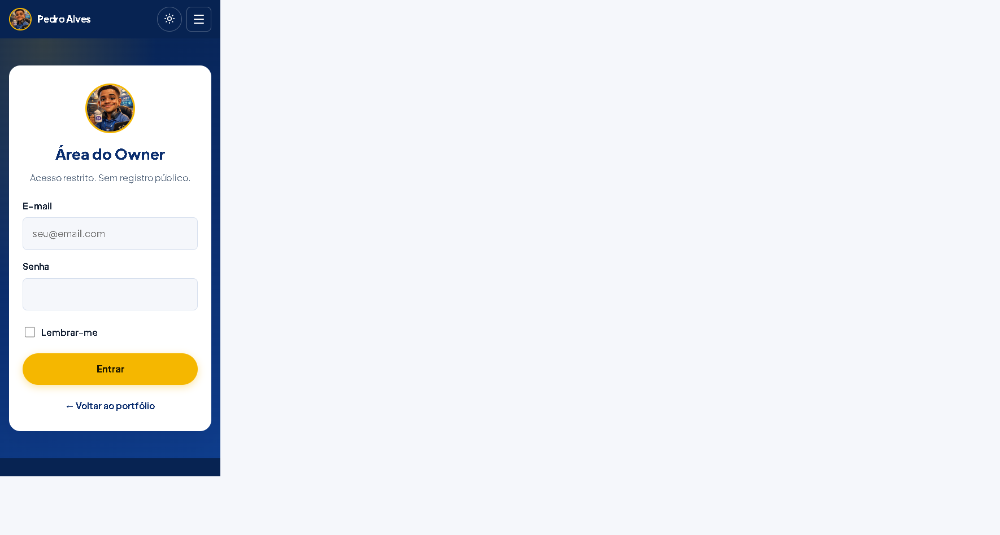
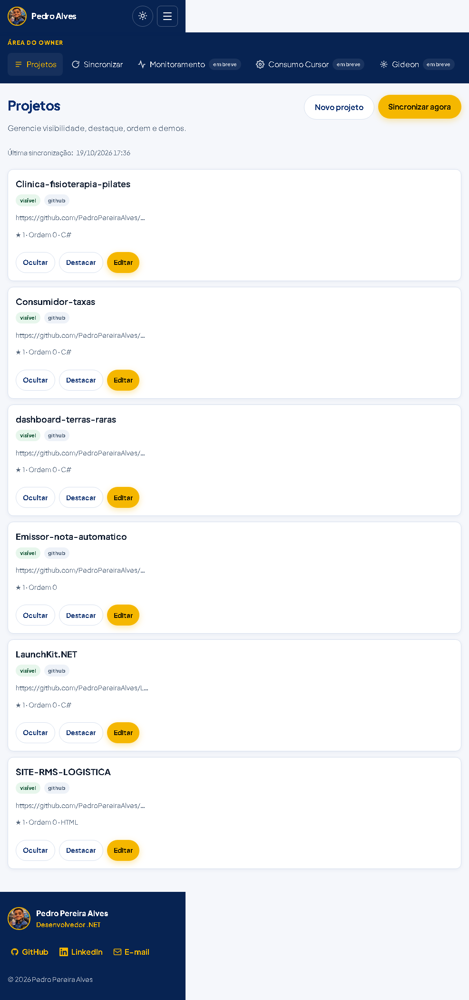
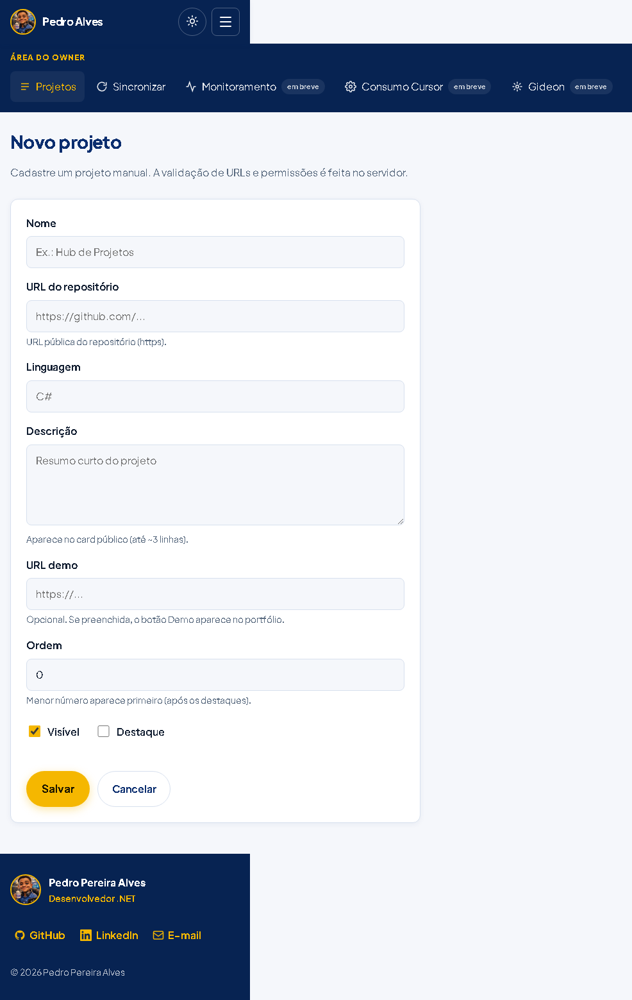

## O quê
Redesenho visual completo do Hub de Projetos no estilo HostGator Brasil (azul profundo + dourado), com tema claro como padrão, toggle de tema escuro, Home/Login/Admin refinados e empty states compactos.

## Por quê
Após o merge da Fase 1 (PR #2), o back-end já cobre login, sync e CRUD, mas o front ficou com tema escuro genérico, pouca hierarquia e empty state ocupando demais a área de projetos. Este PR trata só de apresentação — sem alterar Controllers, Handlers, Identity nem migrations.

## Como testar
1. Partir da branch `feat/front-redesign` (ou deste PR).
2. Subir Postgres + app (Compose ou `dotnet run --project src/PedroHub.Web` com env/user-secrets).
3. Abrir a Home e conferir: header fixo, hero com CTAs/selos, Sobre em 2 colunas, timeline, cards de competências, grid de projetos (6 repos), footer com GitHub/LinkedIn/e-mail.
4. Alternar tema (ícone sol/lua) e recarregar — preferência em `localStorage`.
5. Em viewport ~390px: menu hambúrguer, áreas de toque e sem scroll horizontal.
6. `/Account/Login`: card central, jQuery carregado antes do validate.
7. Login Owner → Admin: sidebar, tabela/cards, chips, `Sincronizar agora` com hora da última sync, Form com ajuda/erros.
8. `dotnet build PedroHub.sln` e `dotnet test PedroHub.sln`.

## Prints
### Home (desktop 1440)

### Home (mobile 390)

### Home (tema escuro)

### Login

### Admin — lista

### Form de projeto

### Lighthouse (mobile) — Home
**Performance 92 · Acessibilidade 100 · Boas práticas 93**

## CI / build
- `dotnet build` e `dotnet test` locais: OK (5 testes).
- Link do CI: aparece automaticamente nas checks deste PR após o push.

## Riscos
- E-mail público do footer (`mailto:`) precisa ser confirmado/ajustado pelo Owner — valor atual é placeholder de contato.
- Admin no mobile empilha a sidebar acima do conteúdo (usável, mas denso); tabela desktop ↔ cards mobile.
- Fontes via Google Fonts (`font-display: swap`); offline/primeira visita pode variar FCP.
- Nenhum framework de UI novo; Bootstrap do template permanece em `wwwroot/lib` mas não é referenciado nas Views.

## O que foi testado
- Home com 6 projetos sincronizados (desktop 1440 + mobile 390 + tema escuro).
- Login, Admin (lista + sync meta) e Form novo projeto.
- Menu mobile, toggle de tema, scroll suave / âncoras `#sobre` `#experiencia` `#competencias` `#projetos`.
- `dotnet build` + `dotnet test`.
- Lighthouse mobile (Performance / Acessibilidade / Boas práticas).

## O que não foi testado
- Deploy no Render / domínio customizado.
- Fluxo completo de sync GitHub com token novo nesta sessão (DB local já tinha os 6 repos).
- AccessDenied / EmBreve só revisados visualmente no markup (mesmo padrão do Login).
- Contraste automatizado além do Lighthouse A11y 100.
- E2E de Ocultar/Destacar/Editar após o redesign (rotas e forms inalterados no servidor).
