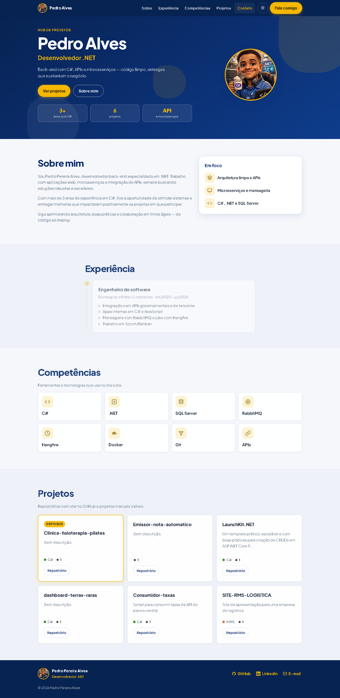
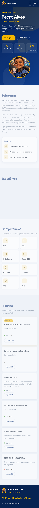
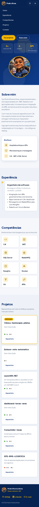
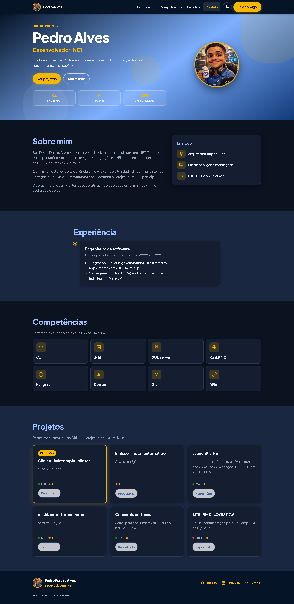
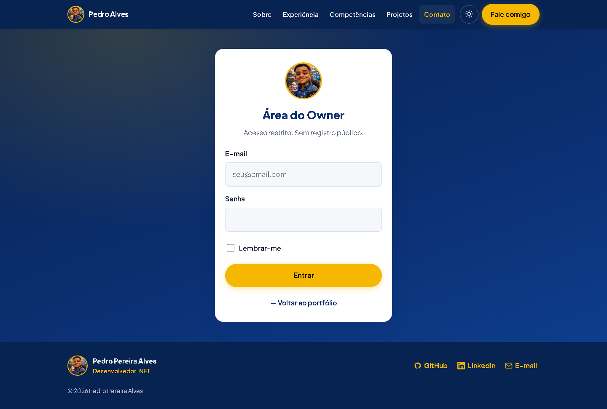
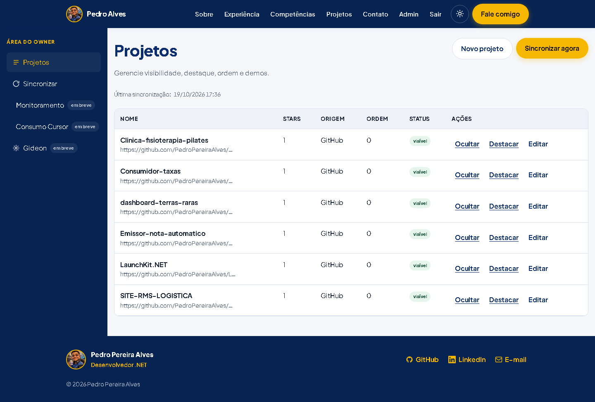
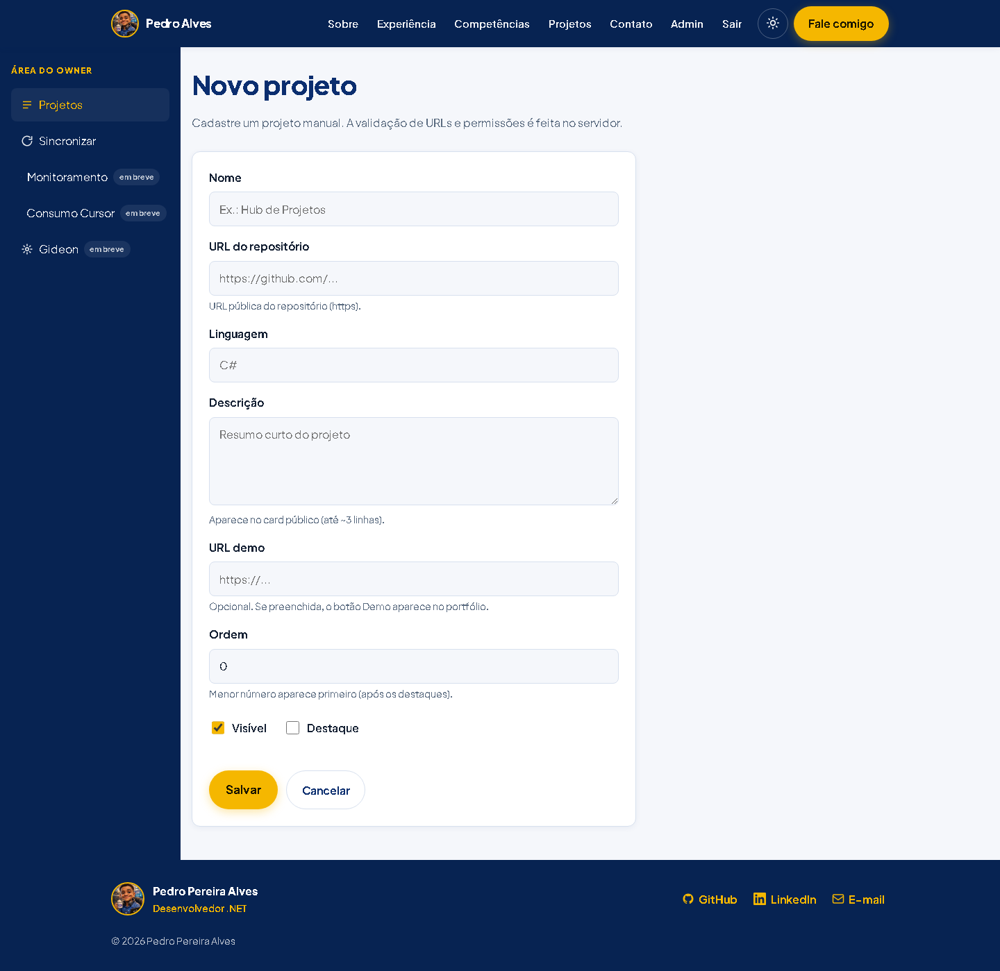
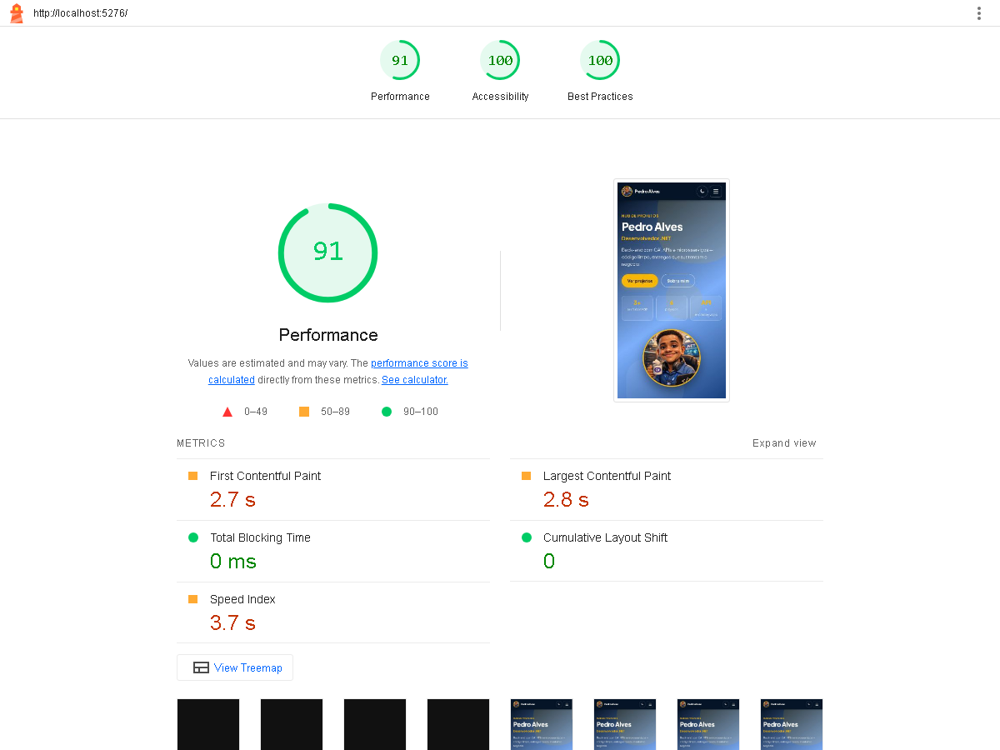

## O quê
Ajustes finais do redesenho visual (PR #3) antes do merge: CSP do tema, conteúdo visível sem JS, tokens CSS, e-mail público, Admin polido e prints reais full-page.

## Por quê
A revisão do PR #3 apontou regressões de qualidade (script inline bloqueado pela CSP, `.reveal` escondendo a Home sem JS, cores soltas, e-mail inventado e prints incompletos). O visual do brief permanece; só apresentação.

## Decisão de produto (login)
Visitante anônimo **não** vê link “Entrar” / “Área do Owner” (header nem footer). Acesso Owner só por URL `/Account/Login`. Com role Owner: header mostra **Admin** + **Sair** (POST com antiforgery), inclusive no menu mobile.

## Como testar
1. Branch `feat/front-redesign`.
2. Subir app + Postgres; abrir Home anônima (sem link de login).
3. DevTools → Console: sem erro de CSP em Home, Login e Admin.
4. Desabilitar JS (ou bloquear `site.js`): seções da Home continuam visíveis.
5. Digitar `/Account/Login`, entrar como Owner → header com Admin + Sair.
6. Admin: ações em linha, sidebar com “Consumo Cursor” + “Gideon (em breve)”, sync com espaços; no mobile sidebar rolável horizontalmente.
7. Footer: `mailto:pedro05vr@gmail.com` + GitHub + LinkedIn.
8. `dotnet build` + `dotnet test`.

## Prints (Playwright, viewport real, fullPage)
| Arquivo | Viewport |
|---|---|
| `home-desktop-1440.png` | 1440×900 full page (6 projetos + Destaque) |
| `home-mobile-390.png` | 390×844 full page |
| `home-mobile-menu-390.png` | 390×844 menu aberto |
| `home-desktop-dark.png` | 1440×900 tema escuro |
| `login-desktop-1440.png` / `login-mobile-390.png` | Login |
| `admin-desktop-1440.png` / `admin-mobile-390.png` | Lista admin |
| `form-desktop-1440.png` / `form-mobile-390.png` | Form |
| `header-owner-1440.png` | Header logado (Admin + Sair) |
| `lighthouse-home-mobile.png` | Lighthouse mobile |

## Lighthouse (mobile, após ajustes)
**Performance 91 · Acessibilidade 100 · Boas práticas 100**

## CI / build
- `dotnet build` e `dotnet test` locais: OK (5 testes).
- Link do CI: checks deste PR após o push.

## Riscos
- Fontes ainda via Google Fonts (`font-display: swap`); FCP pode variar offline.
- Bootstrap permanece em `wwwroot/lib` sem referência nas Views (não removido neste ajuste).
- Sem link de login: Owner precisa lembrar a URL `/Account/Login`.

## O que foi testado
- Console sem erro de CSP (Home, Login, Admin) com `theme-init.js` externo.
- Home com JS e sem animação revel (classe `js` + fallback).
- Login só por URL; Admin + Sair no header quando Owner.
- Destaque em pelo menos 1 projeto; grid com 6 repos.
- Prints Playwright 1440×900 e 390×844 fullPage.
- Lighthouse mobile (BP 100 após CSP).
- `dotnet build` + `dotnet test`.

## O que não foi testado
- Deploy Render / domínio customizado.
- Remoção do Bootstrap de `wwwroot/lib`.
- Fontes locais (woff2) — opcional não feito.
- Fluxo sync GitHub com token novo nesta sessão.
